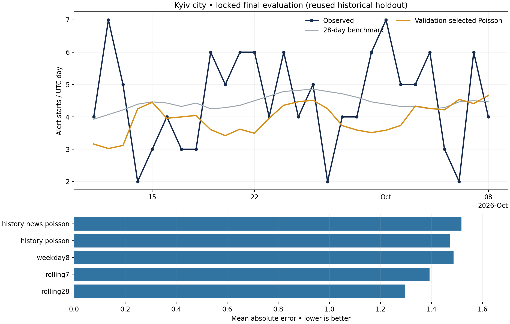

# Ukraine air alerts — compact Poisson forecasting (v0.2)

Forecast Kyiv city's alert-start count on the next UTC calendar day, issued at
12:00 UTC on the preceding day, for civilian shelter staffing and disruption planning.
The project includes actual archived alert/news inputs, a completed backtest, an
executed walkthrough, and per-origin provenance and fit audits.

## What was diagnosed and changed

The previous winning predictor was the 28-day rolling mean. It was working as
written: its slow-moving window made forecasts look almost constant. It won the
previous validation comparison, so flatness was not an estimator malfunction.
The learned alternative had up to **354 inputs (54 numeric + 300 text)** against
**139 initially available training outcomes**. The available label mean also rose
from 1.85 in the initial training portion to 3.75 during validation. This small,
changing series makes long-history estimates and weak text associations fragile.

Version 0.2 addresses the requested modeling constraints:

- **Poisson regression with a log link:** positive expected counts, no clipping
  negative linear predictions and no rounding to integers.
- **Ten history/calendar inputs**, replacing six separately expanded regional
  histories and seven weekday dummies. Nearby regions are aggregated; weekday
  seasonality uses two cyclic coordinates; annual coordinates are removed.
- **Three optional news aggregates + at most 50 unigram TF-IDF terms**. The
  text budget is also capped at `floor(n_train / 3)` inside each eligible fit.
  Constant numeric coordinates are dropped using only that fit's training data.
- Direct Poisson and a Poisson model with a **recent seven-day level offset** are
  compared. The latter learns multiplicative adjustments to an already known
  recent level, helping it adapt to shifts without waiting for a new global mean.
- Validation chooses alpha (`0.01, 0.1, 1`) and training window (`56, 112, all`).
  Both history-only and news models are evaluated: 36 small candidates in total.
- **Physically separate selection and final scoring:** selection receives only
  snapshots and news available before the first test origin. It constructs no
  test rows and drops final revised truth. The saved selection and pipeline hashes
  are checked before final scoring.

As requested, the deployment choice is selected among **Poisson candidates**.
Rolling averages remain separately reported benchmarks. This pool restriction is
explicit: the selected Poisson is not claimed to beat every benchmark.

## Completed results

The validation-selected model uses news + history, the recent-level offset,
alpha 1, and all eligible past training rows. It uses 59–63 features in validation
and 63 on the final period: at most 50 terms plus 13 numeric inputs.

| Model | Validation MAE | Final MAE | Final RMSE |
|---|---:|---:|---:|
| 28-day average benchmark | 2.186 | 1.297 | 1.513 |
| 7-day average benchmark | 2.291 | 1.393 | 1.690 |
| Same-weekday benchmark | 2.254 | 1.487 | 1.854 |
| History Poisson | 2.350 | 1.472 | 1.793 |
| History + news Poisson — deployed choice | 2.307 | 1.518 | 1.810 |

The selected Poisson has validation MAE **2.307**, versus **2.186** for the 28-day
mean benchmark. Final Poisson forecasts range **3.021–4.663 starts/day**, with
24 distinct forecasts at two decimal places over 28 days. The original average
remains more accurate on this period. The revision implements a responsive,
positive count model; it does not establish a forecasting accuracy improvement.

The news-minus-history Poisson MAE difference is +0.046, with an exploratory paired
seven-day moving-block bootstrap interval of [-0.059, +0.106]. This does not
establish a benefit from the sampled news. Broad residual intervals cover all
28 outcomes, with mean width 9.11 starts/day; nominal 90% coverage is not guaranteed.



**Holdout honesty:** version 1 already scored September 11–October 8. This revision
kept that period out of tuning, froze its choice, passed all 25 tests, and only
then scored it once. It remains a **reused historical holdout**, not a fresh unseen
one. A prospective period is required for an independent generalization claim.

## Run

Use **Python 3.12** for the pinned dependencies. After cloning, open a terminal in the 
repo root:

```bash
python -m venv .venv
# macOS/Linux:
source .venv/bin/activate
# Windows activation instead: .venv\Scripts\activate
python -m pip install -r requirements-lock.txt
python -m pip install --no-deps -e .
```

To reproduce the strict workflow:

```bash
python -m ua_alerts.evaluate --stage select --data-dir data --out-dir reports
python -m unittest discover -s tests -v
python -m ua_alerts.evaluate --stage test --data-dir data --out-dir reports
python -m ua_alerts.describe
python -m ua_alerts.forecast --out reports/latest_forecast.json
```

`--stage select` emits validation scores, predictions, source audits and the locked
selection; it produces no test predictions. `--stage test` requires that selection
and unchanged pipeline/split settings. Its output cannot change the selected
configuration. `--stage all` is a convenience for the same two stages consecutively.
The separate stages above allow tests to run before the final evaluation.

Repeated forecasting at the same origin deliberately returns the same value. To
request different historical forecast days, supply different **noon UTC origins**:

```bash
python -m ua_alerts.forecast --origin 2026-10-08T12:00:00Z
python -m ua_alerts.forecast --origin 2026-10-09T12:00:00Z
```

Origins before model selection or after the frozen data cutoff are rejected.
For faster small-matrix runs, set `OMP_NUM_THREADS=1` before launching Python
(macOS/Linux: `export OMP_NUM_THREADS=1`; PowerShell: `$env:OMP_NUM_THREADS="1"`).
Evaluation is offline after dependency installation. Optional Jupyter usage is
in `notebooks/analysis.ipynb`; its Python cells have executed outputs.

## Frozen source data and target

The data vintage remains **October 10, 2026, 03:19:39 UTC** for a controlled revision.
There are 200 commit-pinned alert snapshots and 200 daily GKG samples, March 24–
October 9. The latest full outcome day is October 8; October 9 is partial.
Historical targets span March 26–October 8 (197 days).

- [Vadimkin alert dataset](https://github.com/Vadimkin/ukrainian-air-raid-sirens-dataset):
  volunteer records reach October 9; the official CSV stops in early September.
  Kyiv city is kept distinct from Kyiv oblast and district-level records.
- [Upstream dataset notes](https://github.com/Vadimkin/ukrainian-air-raid-sirens-dataset/blob/main/datasets/README.md):
  timestamps are UTC, volunteer inferred end times exist, and official reporting
  largely moved to district level in late 2025.
- [GDELT 2.1 GKG documentation](https://data.gdeltproject.org/documentation/GDELT-Global_Knowledge_Graph_Codebook-V2.1.pdf):
  one fixed 00:00 UTC 15-minute batch/day, storing headlines, themes and tone.
  This affordable sample is not complete Ukrainian news coverage.

There are 1,852 retained Ukraine-related news records with a title and explicit
`PAGE_PRECISEPUBTIMESTAMP`. Another 1,349 lack that field and are excluded. Use
GDELT's FIPS location code `UP` for Ukraine. Current article bodies or edited
Telegram posts are not used to reconstruct historical inputs. Normalized headlines
are deduplicated only within the available window at a particular origin.

For target day D, count unique Kyiv city starts in `[D 00:00, D+1 00:00)` UTC.
Forecast origin is D-1 at noon, not the start of a rolling next-24-hour outcome.
The latest fully observable alert-history day is usually D-2. This is a count of
recorded alerts, not attacks, damage, duration, or safe times to leave shelter.

## Features and count model

History inputs: collector age, city lag 1 and lag 7, trailing means 3/7/28,
neighbor-aggregate lag 1 and mean 7, weekday sine and cosine.
News aggregates: three-day eligible headline count, mean archived tone, and
conflict-themed headline fraction. Optional TF-IDF uses unigrams, `min_df=3`,
`max_df=0.9`, and English stop words; vocabulary is fitted only on eligible past rows.

Direct model: `expected_count = exp(intercept + X beta)`.
Recent-level model: `expected_count = exposure * exp(intercept + X beta)`, where
`exposure = past_seven_day_mean + 0.5/7`. The fixed half-count permits a zero
historical window without taking `log(0)`.

Because scikit-learn's PoissonRegressor does not expose an offset argument,
the latter fits `y/exposure` with `sample_weight=exposure`. This is algebraically
the count Poisson likelihood with a log-exposure offset, up to constants.
It is not a post-fit clipping or an untrained average. Invalid/nonfinite expected
counts cause a failure rather than being silently repaired.
See [PoissonRegressor](https://scikit-learn.org/stable/modules/generated/sklearn.linear_model.PoissonRegressor.html)
and [weighted count-frequency modeling](https://scikit-learn.org/stable/auto_examples/linear_model/plot_poisson_regression_non_normal_loss.html).

## Chronology and leakage contract

- Initial eligible training outcomes: 139 at the first validation origin.
- Validation targets: August 13–September 9, with daily as-of refits.
- Model-selection instant: September 10 at 12:00 UTC. Every validation target
  has ended and its first complete-day label is available before this instant.
- September 10 target is purged from selection.
- Final targets: September 11–October 8, with daily refits under locked settings.

| Item | Timing requirement |
|---|---|
| Alert input | Matched successful public publisher workflow completion + 6h is strictly before origin. Commit parent matches run head; commit falls inside run. |
| Historical counts | Earlier complete days only; neither `finished_at` nor `naive` determines an input. |
| News | Explicit publication, GKG index and archive availability all precede origin; index/archive availability gets a 2h buffer. |
| Revisions | Later snapshots never rewrite an earlier feature row or first-usable training label. |
| Training | Origin, target end and label availability are strictly before fit; the estimator checks these itself. |
| Transformations | Numeric variance selection, scaling, vocabulary and text budget use only the eligible training set at that origin. |
| Selection | No test rows or test-era news/snapshots enter the selection stage. Final revised truth is dropped from that stage. |
| Daily final refit | Earlier final-period labels can enter later refits only after publication; the chosen model/configuration remain fixed. |
| Scoring | Latest truth is used after selection/testing for final metrics only. |

All 15 original temporal/provenance tests remain, adapted to the Poisson API.
Ten additional tests cover positivity, a learnable synthetic varying signal,
row-dependent text budgets, offset likelihood, future label/text injection,
final-truth isolation, missing news, test-era corruption and lock integrity.
**All 25 passed before final scoring.** Source timestamps, publisher records and
archive headers are the provenance authority; missing alerts and incorrect source
metadata cannot be ruled out by a temporal test.

## Inspect the outputs

| File | What to review |
|---|---|
| `reports/diagnosis.json` | Pre-test diagnosis and old validation comparison. |
| `reports/selection.json`, `selection.sha256` | Complete validation grid, selected settings, explicit candidate pool and integrity lock. |
| `reports/validation_predictions.csv` | All validation-only candidate/benchmark forecasts. |
| `reports/selection_features.csv` | Earlier available rows only; no final truth or test rows. |
| `reports/validation_fit_audit.json` | Selected model's eligible rows, vocabulary and feature counts at each validation origin. |
| `reports/metrics.json`, `predictions.csv` | Completed locked final results and daily positive forecasts. |
| `reports/feature_audit.json`, `training_audit.json` | Source timestamp cutoffs and the selected model's fit cutoffs. |
| `reports/all_test_fit_audit.json` | Both Poisson families' recorded inputs and feature budgets. |
| `reports/tests_before_final.log` | Passing suite before the final evaluation. |
| `reports/latest_forecast.json` | October 9 noon as-of forecast for October 10. |
| `src/ua_alerts/` | Acquisition, as-of features, compact models, selection, scoring and forecast CLI. |
| `data/snapshots/`, `data/news/` | Compact frozen extracts with original source URLs and SHA-256 digests. |

For a newer vintage, use a new directory, an explicit UTC cutoff and a start about
200 days earlier, then repeat selection and final scoring:

```bash
python -m ua_alerts.acquire --data-dir data_new \
  --start YYYY-MM-DD --as-of YYYY-MM-DDTHH:MM:SSZ --workers 6
python -m ua_alerts.evaluate --stage select --data-dir data_new --out-dir reports_new
python -m ua_alerts.evaluate --stage test --data-dir data_new --out-dir reports_new
```

Original transfer archives are omitted to keep the bundle small; compact inputs
reproduce all forecasts. Downloads can be several GB. Alert-data MIT licensing
and publisher attribution are preserved. This is a research planning prototype;
**official warnings determine protective action**.
